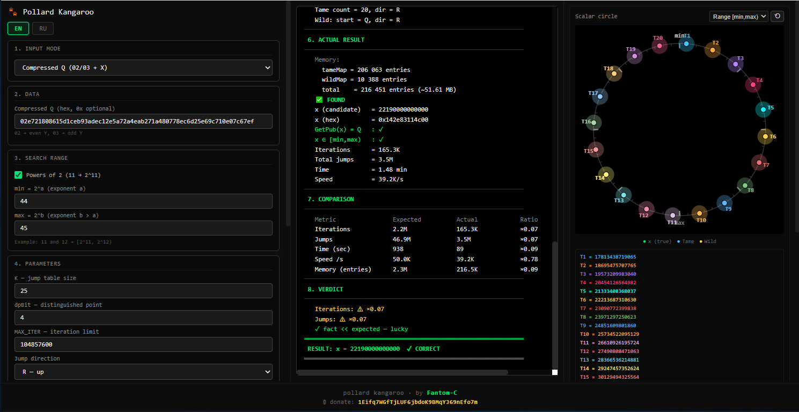

# Pollard's Kangaroo (secp256k1)

[English](#english) · [Русский](#русский)

Browser-only implementation of **Pollard's Kangaroo** algorithm for solving the Elliptic Curve Discrete Logarithm Problem (ECDLP) on the **secp256k1** curve. 
Single self-contained HTML file: no build step, no server, no external dependencies.

---

## English

Browser-only **Pollard's Kangaroo** implementation for **secp256k1**. Designed for educational purposes, algorithm visualization, and solving ECDLP within a known range. Single self-contained HTML file.

### Features

- **Input Modes**:
  - **Private `x`**: test mode with a known private key.
  - **Compressed Q**: `02…` or `03…` public key format.
  - **Public Q.X, Q.Y**: uncompressed public key coordinates.
- **Search Range**: manual input (DEC or HEX) or simplified **Powers of 2** mode (e.g., `min = 2^11`, `max = 2^12`).
- **Algorithm Parameters**: 
  - `K` (jump table size / average jump distance).
  - `dpBit` (Distinguished Point filter to reduce memory usage).
  - `MAX_ITER` (iteration limit).
  - Jump direction (`R` — up, `L` — down).
- **Manual Kangaroos**:
  - Support for **up to 20** simultaneous tame kangaroos (parallelization).
  - Start position modes: **Auto** (evenly distributed across the range), **Manual** (set each start point), or **Random**.
- **Visualizations**:
  - **Scalar Circle**: real-time rendering of Tame and Wild positions (Range or Full `[0, N)` mode).
  - **λ Convergence**: detailed histogram showing Tame and Wild positions, their movement toward each other, and the overlap of their trajectories.
- **Detailed Log**:
  - Built-in **Legend** explaining every symbol and formula (`E[jumps]`, `E[memory]`).
  - Theoretical expectations (expected iterations, time, memory).
  - Real-time progress with memory consumption tracking.
  - Comparison of *Expected vs Actual* results and a verdict based on normal statistical distribution.
- **UI/UX**: English/Russian interface (EN/RU toggle), responsive layout, real-time execution in a Web Worker (UI never freezes).

### Run

Open `index.html` in a browser. Nothing else is required.

### How to use

1. **Input Mode**: Choose "Private x" to test the algorithm locally (e.g., `x = 11111`), or enter a public key to search for an unknown key.
2. **Range**: Set the search range. If using "Powers of 2", entering `20` and `21` will set the range to `[2^20, 2^21)`.
3. **Parameters**: Leave `K`, `dpBit`, and `MAX_ITER` empty to use auto-calculated optimal values, or set them manually.
4. **Click "▶ Start"**: The algorithm will search for the key. Watch the visualizations to see how the "Tame" and "Wild" kangaroos move and eventually collide.

### Security warning

This app is for **educational and research purposes**. Finding a real 256-bit private key is practically impossible using this method (it would take billions of years). Use it only for smaller ranges or for testing.

### Donations

If you find this project useful, you can support it:
**Bitcoin (BTC):** `1Eifq7WGfTjLUF6jbdoK9BMqYJ69nEfo7m`

### License

[MIT](LICENSE)

---

## Русский

Одностраничная браузерная реализация алгоритма **Pollard's Kangaroo** (Метод кенгуру) для решения задачи дискретного логарифмирования (ECDLP) на эллиптической кривой **secp256k1**. 
Один самодостаточный HTML-файл: без сборки, сервера и CDN.

### Возможности

- **Режимы ввода**:
  - **Приватный `x`**: тестовый режим с известным ключом.
  - **Compressed Q**: публичный ключ в сжатом формате `02…` / `03…`.
  - **Public Q.X, Q.Y**: координаты несжатого публичного ключа.
- **Диапазон поиска**: ручной ввод (DEC или HEX) или упрощенный режим **«В степенях 2»** (например, `min = 2^11`, `max = 2^12`).
- **Параметры алгоритма**: 
  - `K` (размер таблицы прыжков / средняя длина прыжка).
  - `dpBit` (фильтр Distinguished Point для экономии памяти).
  - `MAX_ITER` (лимит итераций).
  - Направление прыжков (`R` — вверх, `L` — вниз).
- **Ручные кенгуру**:
  - Поддержка **до 20** одновременных ручных кенгуру (распараллеливание).
  - Режимы старта: **Авто** (равномерно распределяются по диапазону), **Вручную** (задать каждую точку) или **Случайно**.
- **Визуализация**:
  - **Круг скаляров**: отображение позиций Tame и Wild в реальном времени (режим «Диапазон» или «Полный» `[0, N)`).
  - **λ-сходимость (λ convergence)**: подробная гистограмма, показывающая позиции кенгуру, их сближение и пересечение их траекторий.
- **Подробный лог**:
  - Встроенная **Легенда**, объясняющая все символы и формулы (`E[jumps]`, `E[memory]`).
  - Теоретические ожидания (ожидаемые итерации, время, память).
  - Прогресс-бар в реальном времени с отображением расхода памяти.
  - Сравнение *Ожидалось vs Факт* и вердикт на основе нормального статистического распределения.
- **Интерфейс**: English/Русский (переключатель EN/RU), адаптивная вёрстка, выполнение в Web Worker (интерфейс не зависает).

### Запуск

Откройте `index.html` в браузере — больше ничего не нужно.

### Как пользоваться

1. **Режим ввода**: Выберите «Приватный x», чтобы протестировать алгоритм локально (например, `x = 11111`), или введите публичный ключ для поиска неизвестного ключа.
2. **Диапазон**: Задайте диапазон поиска. Если включен режим «В степенях 2», ввод `20` и `21` установит диапазон `[2^20, 2^21)`.
3. **Параметры**: Оставьте поля `K`, `dpBit` и `MAX_ITER` пустыми — система сама подберет оптимальные значения. Или задайте их вручную.
4. **Нажмите «▶ Старт»**: Алгоритм начнет поиск ключа. Наблюдайте за визуализацией, чтобы увидеть, как «ручной» и «дикий» кенгуру движутся и в итоге сталкиваются.

### Безопасность

Приложение предназначено для **образовательных и исследовательских целей**. Найти реальный 256-битный приватный ключ этим методом практически невозможно (на это уйдут миллиарды лет). Используйте его только для небольших диапазонов или тестирования.

### Донаты

Если проект полезен, можно поддержать автора:
**Bitcoin (BTC):** `1Eifq7WGfTjLUF6jbdoK9BMqYJ69nEfo7m`

### Лицензия

[MIT](LICENSE)